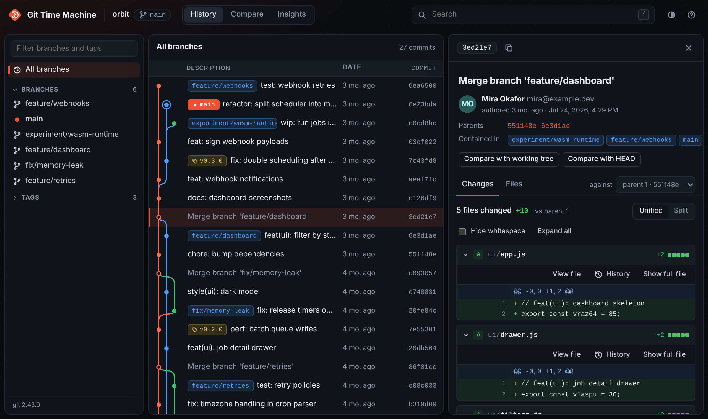

<div align="center">
  

  <h1>Git Time Machine</h1>

  <p>Explore any Git repository's history in your browser.<br>
  Commit graph, diffs, blame, compare and insights. One command, zero dependencies.</p>

  <a href="https://www.npmjs.com/package/git-tm"></a>
  
  
</div>

<br>



## Install

```bash
npm install -g git-tm
```

Or run it once without installing:

```bash
npx git-tm
```

Requires Node.js 18.3 or newer and `git` on your `PATH`.

## Usage

Run it inside any repository (or any folder within one):

```bash
git-tm
```

Then open `http://localhost:7890`, or start it with `git-tm --open` to open the browser for you. Point it at another repository with `git-tm ../other-repo`.

| Option | Description |
| --- | --- |
| `-p, --port <number>` | Port to listen on (default `7890`; the next free port is used if it is busy) |
| `--host <address>` | Interface to bind (default `127.0.0.1`) |
| `-o, --open` | Open the browser once the server is running |
| `--no-avatars` | Do not load author avatars from GitHub or Gravatar |
| `-v, --version` | Print the version |
| `-h, --help` | Print help |

## Features

**History**
- Commit graph with branch lanes, merges, and badges for the current branch, local and remote branches and tags
- Smooth on large repositories: the list is virtualised and history loads page by page as you scroll
- Show all branches or a single branch, tag or remote
- Uncommitted changes appear on top of `HEAD`

**Commits**
- Full message, author and committer, parents, and every branch and tag that contains the commit
- Unified or split diffs with word-level highlights, a hide-whitespace toggle and full-file context
- Merge commits can be diffed against any parent
- Open the commit on GitHub, GitLab or Bitbucket when the repository has a remote

**Browse and blame**
- Walk the file tree as it was at any commit
- View a file at any point in time, with `git blame` alongside
- File history that follows renames

**Time travel (Compare)**
- Travel from any commit, branch or tag to any other, or to your working tree, and see exactly what changes
- Works in every direction: forward (commits applied), back in time (commits undone), or across branches (back to the common ancestor, then forward)
- Step through the journey one snapshot at a time with a slider or the arrow keys; the diff updates at each step
- Pick commits with a searchable picker, with *Time travel* mode in History (click From, then To), from a commit's detail pane, or by shift-clicking a second commit
- *Direct* (`a..b`) or *since branch point* (`a...b`, like a pull request)

**Search**

| Query | Finds |
| --- | --- |
| `fix login` | Commit messages |
| `author:ada` | Commits by an author (name or email) |
| `path:src/app.js` | Commits that touched a path, following renames |
| `code:parseConfig` | Commits that added or removed a string (`git log -S`) |
| `a1b2c3d` | Jumps straight to a commit |

**Insights**
- Activity heatmap for the past year, weekly rhythm by day and hour, and top contributors

**Everything else**
- Light and dark themes (follows your system by default)
- Notices when the repository changes on disk and offers to refresh; if the git-tm process stops, the page says so and reconnects when it is back
- Fetch all remotes with one click
- Keyboard shortcuts: `j`/`k` to move, `Enter` to open, `t` for time travel mode, `←`/`→` to step through a journey, `/` to search, `Esc` to close, `g h`/`g c`/`g i` to switch views, `?` for help
- Works on phones and tablets

## Privacy and safety

- Everything runs locally. The server binds to `127.0.0.1` and rejects requests for other host names, so other websites cannot read your repository.
- Read-only. Git Time Machine never checks out, commits or rewrites anything. The only command that touches the network is **Fetch**, and only when you press it.
- Author avatars are loaded from GitHub (for `users.noreply.github.com` addresses) or Gravatar. Use `--no-avatars` to keep everything offline; initials are shown instead.

## How it works

`git-tm` starts a small HTTP server built on Node's standard library. It asks `git` for machine-readable output (for example `git log --format=...`, `git diff --raw -z`, `git blame --porcelain`), so it works with every Git feature your installed `git` supports: worktrees, submodules, SHA-256 repositories, `.mailmap` and more. The interface is plain HTML, CSS and JavaScript modules, with no framework and no build step.

```
src/
  cli.js           command-line entry point
  server.js        HTTP server and JSON API
  git.js           git commands and output parsing
  public/          the web interface
    js/graph.js    commit graph layout
    js/diff.js     diff rendering
test/              node:test suites
```

## Development

There is nothing to install or build. Clone and run:

```bash
git clone https://github.com/nandhu-44/Git-Time-Machine.git
cd Git-Time-Machine
node src/cli.js .
```

Run the tests:

```bash
npm test
```

Use your working copy as the global `git-tm` command (undo with `npm unlink -g git-tm`):

```bash
npm link
```

Check exactly what would be published:

```bash
npm pack --dry-run
```

### Releasing

Pushing a version tag publishes to npm from GitHub Actions ([`publish.yml`](.github/workflows/publish.yml)), using npm trusted publishing, so no npm token is stored anywhere.

```bash
npm version patch
```

```bash
git push origin main --follow-tags
```

`npm version` bumps `package.json`, commits and creates the `vX.Y.Z` tag. Use `minor` or `major` as needed. The workflow checks that the tag matches `package.json`, runs the tests and publishes.

GitLab CI ([`.gitlab-ci.yml`](.gitlab-ci.yml)) runs the same tests. It publishes only if an `NPM_TOKEN` CI/CD variable is set, so a mirrored tag is not published twice.

## Background

Git Time Machine started at [FOSS Hack 2025](https://fossunited.org/fosshack/2025). Version 1 is a complete rewrite focused on speed, a clean interface and deeper Git features.

## License

[MIT](LICENSE)
